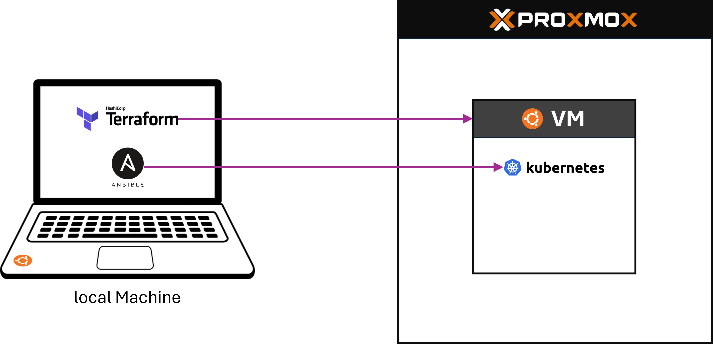

# Proxmox deployment

**Example VM configuration:** ID `100`, Ubuntu 24.04, IP `10.10.10.20/24`, 4 vCPUs, 16 GiB (16384 MiB) RAM, 30 GiB disk. The defaults are declared in `deployment/terraform/variables.tf` and must be available and authorized on the target host before provisioning.

This guide explains how to provision an Ubuntu virtual machine on Proxmox VE using **Terraform** and configure a single-node **k3s** cluster using **Ansible**.



Run Terraform and Ansible from the **local machine**, using a Linux-compatible command-line environment with this repository checked out. The Proxmox host acts as an SSH jump server, and the Ubuntu VM is the Ansible target.


## Backup and restore commands

Run these commands from the repository root on the **operator workstation** (not inside the VM):

- `bash deployment/scripts/create_backup.sh prod k3s-vm` creates a verified, encrypted backup of the `prod` namespace. It requires the configured age identity and approval for a short maintenance interruption.
- `bash deployment/scripts/restore_backup.sh 101` restores the latest verified production backup onto an already provisioned recovery VM, with a matching per-VM Terraform workspace.

The `deployment/dr/` directory contains lower-level disaster-recovery helpers, including `deployment/dr/restore.sh` for individual restore stages. See the [disaster-recovery runbook](../docs/disaster-recovery.md) for prerequisites and manual recovery.

## Automated, independent VM deployments

From the repository root on the operator workstation:

```bash
./deployment/scripts/deploy.sh 103 27
./deployment/scripts/deploy.sh 104 28 --infra-only
./deployment/scripts/destroy.sh 103
```

**No `terraform.tfvars` file is required.** Common Proxmox settings are defined as defaults in
`deployment/terraform/variables.tf` (including node, VNet, gateway, Cloud Image,
CPU, RAM and storage). Terraform's built-in `-var` flags supply the requested
VM ID, derived name, IP and `create_vm=true`. The first command provisions
VM 103 at `10.10.10.27/24` under the example defaults, using the isolated
Terraform workspace `vm-103`.

The last argument is the **last IPv4 octet**, not a port. The first three octets
come from the `vm_ipv4_cidr` Terraform default (or optional override).
Our two-argument interface currently supports `/24` only.

To customize the shared settings for another Proxmox host **without creating
any configuration file**, use Terraform's standard environment variables:

```bash
export TF_VAR_node_name="YOUR_PROXMOX_NODE"
export TF_VAR_network_bridge="YOUR_VNET"
export TF_VAR_vm_ipv4_cidr="10.50.0.20/24"
export TF_VAR_vm_gateway="10.50.0.1"
export TF_VAR_cloud_image_file_id="local:import/YOUR_IMAGE.qcow2"
./deployment/scripts/deploy.sh 103 27
```

You can also edit the version-controlled defaults in `variables.tf` for this
learning project. Terraform accepts `terraform.tfvars` if you deliberately
choose to use one, but it is **optional**.

Each VM has its own workspace state, saved locally in
`deployment/terraform/terraform.tfstate.d/` (Git-ignored). No generated
per-VM variable files are needed. A repeat invocation checks that an existing
VM's ID and IP match the requested values, rather than silently changing
its identity. Destruction selects the named workspace and verifies its state.
The scripts still ask for confirmation.

**Existing VMs managed in Terraform's `default` workspace are not
automatically migrated.** Do not recreate an already existing Proxmox VM ID
in a new workspace.

After Terraform, `deploy.sh` waits for SSH/Cloud-Init, configures k3s with
Ansible, then bootstraps the dev application and Argo CD. Argo CD dev tracks
the branch selected for bootstrap (for example `maximize-automation`).
Use `--infra-only` to stop after k3s. The initial Airflow ETL trigger
remains a separate command.

## Deployment overview

- **One-time Proxmox preparation:** download the Ubuntu Cloud Image, verify the NAT VNet, create the API token, and grant it the shared storage and VNet permissions (Section 2). These actions require authorized Proxmox administration.
- **Before creating or recreating a VM:** verify and, if necessary, grant that specific VM ID's `/vms/VM_ID` ACL. On this host, destroying a VM has removed its VM-specific ACL; the shared storage/VNet permissions remain (Section 2).
- **VM + k3s deployment:** from the local machine, verify the defaults in `deployment/terraform/variables.tf`, trust the Proxmox CA, and run `./deployment/scripts/deploy.sh VM_ID LAST_IP_OCTET` (Section 3). The script plans/applies Terraform **only after confirmation**, waits for SSH and Cloud-Init, then invokes Ansible to install/configure k3s and verify the node. The restricted `jumpuser` SSH account must already be configured on Proxmox (Section 2).
- **After deployment:** use the optional SSH alias for interactive access (Section 4), or rerun the Ansible playbook manually for troubleshooting (Section 5). **With `--infra-only`, the application is not deployed.** To bootstrap it later, run [`deployment/scripts/setup_vm.sh`](kubernetes/README.md#quick-start-setup_vmsh-recommended-for-a-fresh-vm) to clone the repository, configure Elasticsearch, deploy the application and bootstrap Argo CD, then run [`deployment/scripts/init_airflow.sh`](kubernetes/README.md#quick-start-init_airflowsh) to trigger the first ETL.

This guide assumes a Proxmox host is already available; it does not install Proxmox itself. Follow the prerequisites and procedures below before deploying. Never assume the example VM ID, private IP, subnet, VNet or permissions are available on another host. Keep the Terraform state for repeat runs.

## Configuration names

The commands below use these names; replace their values with those for your environment:

- `PROXMOX_HOST`: public hostname or IP of the Proxmox host.
- `VM_ID`: a free Proxmox VM ID (100 or greater).
- `VM_IP`: assigned *private* IPv4 address of the Ubuntu VM, **without CIDR**.
- `SDN_ZONE`: identifier of the Proxmox Simple zone.
- `SDN_VNET`: identifier of the VNet connected to the VM.
- `VM_USER`: Ubuntu username configured through Cloud-Init.
- `jumpuser`: restricted local SSH account on the Proxmox host.

## Prerequisites

- A running Proxmox VE host, its web interface, and **root access to the Proxmox Linux shell** (run `id -u` in the Proxmox shell; the result must be `0`).
- HTTPS access to the Proxmox API (TCP 8006) and SSH access to the host (TCP 22) from the local machine (check with `nc -vz PROXMOX_HOST 8006` and `nc -vz PROXMOX_HOST 22`).
- A Proxmox datastore supporting **Import** files and VM disks (check `cat /etc/pve/storage.cfg`; the selected datastore's `content` entry must include `import` and `images`).
- An available private subnet (check existing ranges with `ip -4 route` and `cat /etc/pve/sdn/subnets.cfg` on Proxmox; choose a non-overlapping private subnet).
- Permission to configure a **Simple SDN zone** (requires Proxmox administrator privileges, available through the root shell; view existing zones with `pvesh get /cluster/sdn/zones`).
- Permission to configure a **VNet and Source NAT (SNAT)** (same administrator access; view existing VNets with `pvesh get /cluster/sdn/vnets`).
- The Proxmox host must have internet access so that VMs can reach the internet through NAT (check from Proxmox with `curl -I --max-time 10 https://cloud-images.ubuntu.com`).
- Installed on the **local machine**: **Terraform**, **Ansible**, **OpenSSH** and **curl** (check with `terraform version`, `ansible --version`, `ssh -V` and `curl --version`).

## 1. Prepare an SSH key on the local machine

Create the key-pair (`id_ed25519`/`id_ed25519.pub`) on the local machine:

```bash
test -f ~/.ssh/id_ed25519.pub || ssh-keygen -t ed25519 -f ~/.ssh/id_ed25519
```

## 2. Prepare Proxmox

### Download the Ubuntu Cloud Image

In the Proxmox web interface, open **Datacenter → Storage** and ensure the selected datastore allows **Import** content.

Then open **Datacenter → your node → local → Import → Download from URL**:

- URL: `https://cloud-images.ubuntu.com/noble/current/noble-server-cloudimg-amd64.img`
- Filename: `job-market-noble-server-cloudimg-amd64.qcow2` (must match the default `cloud_image_file_id`)

On the Proxmox **host** shell, confirm that the image is available:

```bash
pvesm list local --content import
```

Ensure the image's identifier matches the `cloud_image_file_id` default in `deployment/terraform/variables.tf`, or override it using `TF_VAR_cloud_image_file_id`. If the image is **already present**, reuse it instead of downloading again. `qemu-img info` can confirm the QCOW2 format but does not by itself guarantee a complete download; verify the source/checksum when preparing a new image. **Image download happens manually through the Proxmox web interface, not through Terraform.**

### Configure a private network with NAT

Configure the network in the Proxmox web interface before creating the VM:

1. Go to **Datacenter → SDN → Zones → Add → Simple**. Create a Simple zone, assigning it an ID (`SDN_ZONE`) and selecting the node that will run the VM.
2. Go to **Datacenter → SDN → VNets → Add**. Create a VNet (`SDN_VNET`) and assign it to that Simple zone.
3. Select the VNet, open **Subnets**, and add an IPv4 subnet with the chosen CIDR range and gateway address. **Enable SNAT** on the subnet.
4. Go to **Datacenter → SDN** and click **Apply** to activate the configuration.

For example, a subnet of `10.50.0.0/24` with gateway `10.50.0.1` can serve a VM at `10.50.0.10/24`. Use an address range that does not overlap existing networks. Do not assign the gateway address to the VM.

**SNAT** lets the VM reach the internet through the Proxmox host's outgoing connection. The VM stays on a private IP; inbound access from the local machine uses the SSH jump account configured below.

The defaults in `deployment/terraform/variables.tf` must match the SDN settings,
or you can override them with Terraform environment variables:

```bash
export TF_VAR_network_bridge="SDN_VNET"
export TF_VAR_vm_ipv4_cidr="10.50.0.20/24"
export TF_VAR_vm_gateway="10.50.0.1"
```

The deployment script uses the template address's first three octets and
replaces the last octet with your CLI argument.

Replace `SDN_VNET` and the example addresses with the actual VNet ID, chosen VM IP/CIDR and subnet gateway. Terraform attaches the VM to **the VNet**, not the zone.

### Create a Proxmox API token and permissions

**Two distinct kinds of permission are needed:** shared infrastructure permissions are configured once, while the permission for the **specific VM ID must be checked before creating or recreating that VM**. These are administrator tasks on the **Proxmox host**, not tasks performed by `deployment/scripts/deploy.sh`.

#### A. One-time setup: API token and shared storage/VNet permissions

In **Datacenter → Permissions → API Tokens**, create a token (for example `terraform` owned by `root1@pve`) with **Privilege Separation** enabled. Save the token secret securely. The token ID `root1@pve!terraform` identifies the token; `deployment/scripts/deploy.sh` prompts for the complete `ID=secret` value. An API token is not an SSH login.

For this bootcamp host, the shared resources and privileges are:

| ACL path | Role/privileges | Purpose |
| --- | --- | --- |
| `/storage/local` | Custom role with `Datastore.AllocateSpace` and `Datastore.Audit` | Allocate and inspect VM disks |
| `/sdn/zones/studnat/nat0` | `PVESDNUser` (including `SDN.Use`) | Attach VM network interfaces to `nat0` |

The actual SDN zone is **`studnat`**, not `private`; verify it with `pvesh get /cluster/sdn/vnets`. The `network_bridge` variable in `variables.tf` is the VNet ID `nat0`, not its zone name.

On the **Proxmox root shell**, with permission to administer this shared host, run the following when setting up a new environment. Create `TerraformVMStorage` only if it does not already exist (`pveum role list`):

```bash
TOKEN_OWNER='root1@pve'
TOKEN_ID='root1@pve!terraform'
DATASTORE='local'
SDN_ZONE='studnat'
SDN_VNET='nat0'

pveum role add TerraformVMStorage --privs "Datastore.AllocateSpace Datastore.Audit"

pveum acl modify "/storage/$DATASTORE" \
    --roles TerraformVMStorage --users "$TOKEN_OWNER" --tokens "$TOKEN_ID"
pveum acl modify "/sdn/zones/$SDN_ZONE/$SDN_VNET" \
    --roles PVESDNUser --users "$TOKEN_OWNER" --tokens "$TOKEN_ID"
```

Both the **owner** and the **privilege-separated token** must have the required privileges; Proxmox uses their effective intersection. Check these permissions (they normally survive VM deletion):

```bash
pveum user token permissions root1@pve terraform --path /storage/local
pveum user token permissions root1@pve terraform --path /sdn/zones/studnat/nat0
```

Expect `Datastore.AllocateSpace` and `SDN.Use`, respectively.

#### B. Before each new VM creation or recreation: VM-specific permission

**Recreating a VM:** Verify its VM-specific API permissions before provisioning. After the new guest starts, its SSH host key may also differ from the previous installation; follow the **SSH host-key security** instructions in Section 3 to verify and update the trusted key. These are separate checks, regardless of whether the previous VM was removed through Proxmox or Terraform.

Unlike the shared ACLs, `/vms/VM_ID` permissions apply to **one VM ID**. Removing a VM may also remove its ACL. Consequently, **check and reassign the VM-specific permissions before each VM creation or recreation**; missing permissions can cause an HTTP 403 response.

Before deploying a new or previously destroyed VM, check the token's effective permission on the intended VM ID. **Replace `VM_ID` with the intended ID** (for example, `100`). On the **Proxmox root shell**:

```bash
pveum user token permissions root1@pve terraform \
    --path /vms/VM_ID
```

If the output does not include `VM.Allocate`, restore permissions for this VM ID **only**:

```bash
pveum acl modify /vms/VM_ID \
    --roles PVEVMAdmin \
    --users root1@pve \
    --tokens 'root1@pve!terraform'
```

Run the first command again to verify `VM.Allocate` (and the `VM.Config.*` privileges). Use only an approved, unused VM ID; the example configuration uses **100**. Do **not** give the token cluster-wide VM administration permissions.

The essential distinction:

- **One-time host setup:** create the token and configure permissions for shared storage and VNet (Section A).
- **Per-VM provisioning/reprovisioning:** check `/vms/VM_ID` and grant `PVEVMAdmin` there when missing (Section B). Recheck after `deployment/scripts/destroy.sh`, because VM deletion can remove this ACL.

If `VM.Allocate` is still absent, check the underlying owner permissions with `pveum user permissions root1@pve --path /vms/VM_ID` (substitute the ID). **HTTP 401** indicates an authentication issue (invalid token/secret), while **HTTP 403** generally indicates insufficient authorization.

##### Verify a new or recreated VM's SSH host key and reconnect

A newly created or rebuilt Ubuntu VM normally has a **different SSH host
key**, even if its IP address has been used before. The first SSH attempt may
show `WARNING: REMOTE HOST IDENTIFICATION HAS CHANGED!`. This is a security
check, not evidence that Terraform failed. **Stop any SSH retry loop with
Ctrl+C**; the VM already exists and does not need to be recreated.

The recommended approach is to verify the ED25519 fingerprint **inside the
guest**, through VM's trusted Proxmox web console (**VM → Console**):

```bash
ssh-keygen -lf /etc/ssh/ssh_host_ed25519_key.pub
```

Compare its complete `SHA256:...` value with the fingerprint SSH reports on
your workstation. If they differ, investigate; do not disable host-key
checking or blindly accept a new key.

**Proxmox-host cross-check when guest console login is unavailable:** Our
Terraform Cloud-Init configuration supplies the guest's SSH public key but
does not set a login password, so an interactive Proxmox guest console may
display a login prompt that you cannot use. From the **Proxmox host shell as
root**, replace the example VM ID/IP with the intended guest:

```bash
VM_ID=101
VM_IP=10.10.10.21

qm config "$VM_ID" | grep '^net0:'
ip neigh show "$VM_IP"
ssh-keyscan -T 5 -t ed25519 "$VM_IP" 2>/dev/null | ssh-keygen -lf -
```

Check that the neighbor MAC address (when resolved) agrees with the MAC on
the VM's `net0` configuration. If no neighbor entry appears, a short ping
from the Proxmox host may populate it; a stale or incomplete neighbor entry
is **not** proof of identity. Compare the fingerprint returned by
`ssh-keyscan` with the one the local SSH client reported. **This is a
practical lab cross-check from the trusted hypervisor network, not
cryptographic proof:** `ssh-keyscan` itself does not authenticate the
server and might see the same impersonator as the workstation. For stronger
assurance, obtain the fingerprint inside the guest via a trusted console or
other independently authenticated channel.

**Only after establishing that the new host key belongs to the intended
VM**, remove the outdated entry on the **local workstation** as the same
user who runs `deployment/scripts/deploy.sh`, and reconnect:

```bash
VM_IP=10.10.10.21
PROXMOX_HOST=195.154.103.231

ssh-keygen -f "$HOME/.ssh/known_hosts" -R "$VM_IP"
ssh -J "jumpuser@$PROXMOX_HOST" "group3@$VM_IP"
```

Substitute your actual VM IP, Proxmox host and Cloud-Init username. For a
`root@` workstation shell, `$HOME/.ssh/known_hosts` is
`/root/.ssh/known_hosts`. Accept the SSH key only after checking the
displayed fingerprint against the previously verified one. In this setup,
`group3` logs in using the SSH key installed by Cloud-Init, **not a
password**. Never remove the old entry simply to silence a warning.

When SSH works, exit the guest session and rerun `./deploy.sh` from the
**same Terraform working directory/state** (with `EXPECTED_VM_ID` set to
the intended VM ID when it is not 100). Terraform should report no VM
changes, then continue with Cloud-Init and Ansible. Inspect the plan before
confirming. If the jump account instead reports
`channel 0: open failed: administratively prohibited`, check its
`permitopen` restrictions in the next section; that is a separate issue.

`No route to host` or `Connection refused` during initial attempts can
also mean the VM is still booting; persistent failures require network/SSH
diagnosis.

### Create the SSH jump account

Run on the **Proxmox host** as root:

```bash
adduser --disabled-password --gecos "" jumpuser
install -d -m 700 -o jumpuser -g jumpuser /home/jumpuser/.ssh
sshd -T | grep -E '^(pubkeyauthentication|allowtcpforwarding)'
```

Confirm that SSH public-key authentication and TCP forwarding are enabled (using the `sshd -T` command above). The `authorized_keys` file **does not enable these SSH server settings**; it authorizes your local machine's public key for the jump account.

In the **Proxmox Linux shell**, create `/home/jumpuser/.ssh/authorized_keys` containing **one line**:

```text
restrict,port-forwarding,permitopen="VM_PRIVATE_IP:22",command="/bin/false" ssh-ed25519 AAAA... comment
```

Replace `VM_PRIVATE_IP` with the assigned private IP of the VM. Replace **`ssh-ed25519 AAAA... comment` entirely** with the complete output of `cat ~/.ssh/id_ed25519.pub` from your **local Linux machine** (Step 1). The restrictions and public key must be on the **same line**, separated by a single space.

Create/edit the file and set the correct ownership and permissions on **Proxmox**:

```bash
nano /home/jumpuser/.ssh/authorized_keys
chown jumpuser:jumpuser /home/jumpuser/.ssh/authorized_keys
chmod 600 /home/jumpuser/.ssh/authorized_keys
```

This key allows SSH forwarding to the VM's port 22 without granting root
privileges on Proxmox.

**Multiple VMs, for example a temporary disaster-recovery guest:** if the
same workstation key must access two approved guests, add a separate
`permitopen` option for each exact IP/port **on the same authorized-key
line**:

```text
restrict,port-forwarding,permitopen="10.10.10.20:22",permitopen="10.10.10.21:22",command="/bin/false" ssh-ed25519 AAAA... comment
```

Keep the original `ssh-ed25519 AAAA... comment` public key in place; do not
replace it with the literal placeholder. This permits forwarding only to
those two guests, not arbitrary ports. No sshd restart is required after
editing `authorized_keys`. Remove the second `permitopen` when the
temporary guest is destroyed.

From the **trusted Proxmox web console**, run:

```bash
ssh-keygen -lf /etc/ssh/ssh_host_ed25519_key.pub
```

Keep the displayed `SHA256:...` fingerprint available for comparison (for example, in a temporary text file).

From your **local Linux machine**, initiate the first SSH connection to Proxmox (replace `PROXMOX_HOST` with its hostname or IP address):

```bash
ssh jumpuser@PROXMOX_HOST
```

SSH will show an authenticity warning and an **ED25519 key fingerprint**, followed by `Are you sure you want to continue connecting (yes/no/[fingerprint])?`. Compare the complete `SHA256:...` value with the fingerprint from the Proxmox web console. **Only if they match**, type `yes`. SSH stores the accepted host key in `~/.ssh/known_hosts`; the jump account may then close the interactive session because it is restricted to forwarding.

This verifies the **server's identity**. It is distinct from your personal SSH key used for login.

### Copy the Proxmox CA certificate

From the **Proxmox host's trusted web console**, display:

```bash
cat /etc/pve/pve-root-ca.pem
```

Copy the full PEM certificate (including its BEGIN/END lines) to a local file on the local machine, for example `~/.config/proxmox/pve-root-ca.pem`:

```bash
mkdir -p ~/.config/proxmox
nano ~/.config/proxmox/pve-root-ca.pem
```

This establishes TLS trust for Terraform's API connection. Verify the certificate through the trusted Proxmox console; do not disable TLS verification.

## 3. Configure and run Terraform with `deployment/scripts/deploy.sh`

On your **local workstation**, verify that the one-time Proxmox prerequisites
are ready: an approved free VM ID, preconfigured NAT VNet and gateway, imported
Ubuntu Cloud Image, access token with VM-specific permissions, matching SSH
key and trusted CA certificate (Sections 1–2).

The default values are version-controlled in
`deployment/terraform/variables.tf`. No example file or
manually created `terraform.tfvars` is needed. Override shared defaults
through `TF_VAR_...` environment variables when necessary.

```bash
./deployment/scripts/deploy.sh 103 27
```

The script creates or selects workspace `vm-103`, uses the configured
`/24` subnet to derive the guest IP, and runs Terraform with explicit
`-var` values for `create_vm`, `vm_id`, `vm_name` and `vm_ipv4_cidr`.
It refuses deletion/replacement actions in the saved plan and asks you to
type `apply 103` before applying. It uses the same workspace on reruns.

Then the script waits for SSH and Cloud-Init, invokes Ansible to install
k3s, and bootstraps the application and Argo CD. If you only need k3s,
pass `--infra-only`.

The Proxmox endpoint defaults to the project's training host; set
`PROXMOX_HOST` to use another one. To use a different jump account, set
`JUMP_USER`. Terraform credentials are read from
`PROXMOX_VE_API_TOKEN` or requested interactively. Never commit tokens,
private keys or Terraform state.

**SSH host-key security:** verify the host-key fingerprints reported by
SSH against the trusted Proxmox and guest consoles. If you recreate a VM
at the same IP, verify its new host key before removing the old known-hosts
entry. The script does not disable host-key checking.

**If SSH, Cloud-Init or Ansible fails after Terraform succeeds**, the VM
remains managed by its workspace. Fix the issue and rerun the same command.
A Cloud-Init exit code of 2 is reported as a recoverable error; fatal errors
stop the provisioning process.

`terraform fmt` can format the configuration. Do not set
`create_vm=false` as a manual way to "skip deployment": it may plan
destruction of an existing VM. Use the dedicated destroy script instead.

### Destroy a Terraform-managed VM with `deployment/scripts/destroy.sh`

```bash
./deployment/scripts/destroy.sh 103
```

This selects workspace `vm-103`, ensures that its state manages VM 103
and verifies its recorded IP. It refuses to destroy an untracked VM or a VM
whose ID does not match its workspace. You must type `destroy 103`
before the saved Terraform plan is applied. VM 100 has an additional
`ALLOW_DESTROY_VM100=true` safeguard.

Other workspaces remain untouched. The emptied workspace is retained for
later redeployment. VM disks are deleted along with the VM; the imported
Cloud Image and Proxmox VNet remain available. Deleting a VM may also
remove the Proxmox ACL for its VM ID, so verify permissions before recreation.

**Recovery:** `deployment/scripts/restore_backup.sh 103` likewise
selects workspace `vm-103` and checks its Terraform state before
restoring a verified backup. See the
[disaster-recovery runbook](../docs/disaster-recovery.md).

## 4. Optional: SSH alias for interactive VM access

`deployment/scripts/deploy.sh` uses SSH with `-J jumpuser@PROXMOX_HOST` directly, so **you do not need to edit `~/.ssh/config` for automated deployment**. To connect interactively using the shorter `ssh k3s-vm` command, edit `~/.ssh/config` on the local machine and replace the host, guest IP and username:

```sshconfig
Host proxmox-jump
    HostName PROXMOX_HOST
    User jumpuser
    IdentityFile ~/.ssh/id_ed25519
    IdentitiesOnly yes

Host k3s-vm
    HostName VM_PRIVATE_IP
    User VM_USER
    ProxyJump proxmox-jump
    IdentityFile ~/.ssh/id_ed25519
    IdentitiesOnly yes
```

```bash
chmod 600 ~/.ssh/config
ssh k3s-vm
```

The guest login public key was installed by Terraform/Cloud-Init, so
no manual `ssh-copy-id` to the new guest is needed. For a direct interactive
connection without an alias, use
`ssh -J jumpuser@PROXMOX_HOST VM_USER@VM_PRIVATE_IP` (replace the placeholders).
On first connection or after a guest rebuild, verify the guest's SSH
host-key fingerprint as detailed in **“Verify a new or recreated VM's SSH
host key and reconnect”** in Section 2B. If an old host key is stored,
remove the entry with `ssh-keygen -R VM_PRIVATE_IP` **only after** that
verification. The guest uses SSH-key login; Cloud-Init does not configure
a console login password.

While logged into the **Ubuntu VM**, verify its address, route, internet access and DNS:

```bash
ip -br addr
ip route
ping -c 3 VM_GATEWAY_IP    # Replace with the subnet gateway from step 2
ping -c 3 1.1.1.1
getent hosts ubuntu.com
sudo apt update
```

The VM should show its configured private IP, a default route via the subnet gateway, and successful outbound network and DNS access. Terraform passes the IP, gateway and DNS settings through **Cloud-Init**, so **do not create a second Netplan configuration manually**.

Exit the guest session to return to the local Linux shell.

## 5. k3s with Ansible (run automatically by `deployment/scripts/deploy.sh`)

`deployment/scripts/deploy.sh` now runs the existing `deployment/ansible/install-k3s.yml` playbook after SSH and Cloud-Init are ready. It creates a temporary inventory from Terraform outputs, runs an Ansible ping, installs/configures k3s, then verifies the node and namespaces. No separate inventory file is needed for the automatic deployment.

For **manual troubleshooting or replaying the playbook**, first configure the optional `k3s-vm` SSH alias in Section 4. Then, from the **repository root** on the local machine:

```bash
cd deployment/ansible
cat > inventory.ini <<'EOF'
[k3s_servers]
k3s-vm ansible_connection=ssh ansible_python_interpreter=/usr/bin/python3
EOF

ansible -i inventory.ini k3s_servers -m ping
ansible-playbook -i inventory.ini install-k3s.yml
```

The Ubuntu Cloud-Init account must have working `sudo` privileges for the playbook's `become: true` tasks. The automatic script assumes passwordless sudo; if the account requires a sudo password, the manual command can supply it with `--ask-become-pass`.

The playbook installs and enables k3s, waits for a Ready node, and applies the `dev` and `prod` namespace manifest. Re-run the same playbook to verify that it makes no unnecessary changes.

Verify the installation:

```bash
ssh k3s-vm 'sudo k3s kubectl get nodes'
ssh k3s-vm 'sudo k3s kubectl get namespaces'
```

**Result:** `./deploy.sh` provisions or updates the Ubuntu VM using Terraform and configures its single-node k3s cluster with Ansible, provided the Proxmox token, VM-specific ACL, SSH jump account and trusted host keys are prepared.

