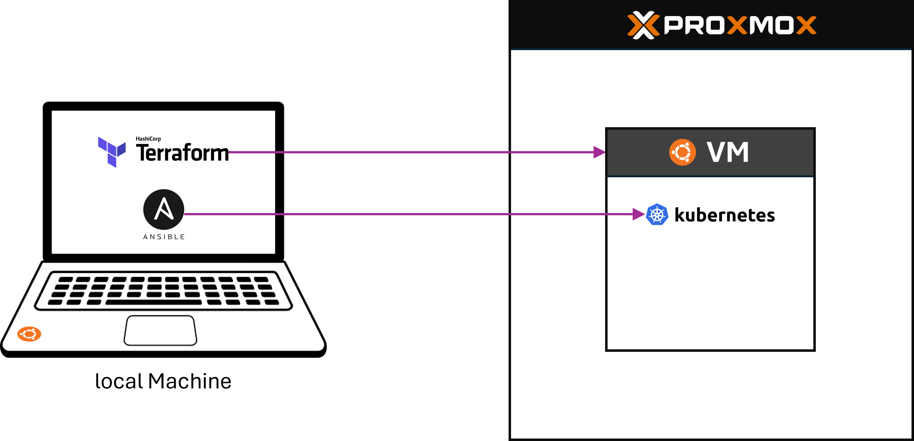

# Proxmox deployment

This guide explains how to provision an Ubuntu virtual machine on Proxmox VE using **Terraform** and configure a single-node **k3s** cluster using **Ansible**.



Run Terraform and Ansible from a local Linux machine with this repository checked out. The Proxmox host acts as an SSH jump server, and the Ubuntu VM is the Ansible target.

## Deployment overview

- **One-time Proxmox preparation:** stage the Ubuntu Cloud Image, verify the NAT VNet, create the restricted API token and assign its ACLs (Section 2). These actions require authorized administration on the Proxmox host.
- **VM provisioning:** from a local Ubuntu/Linux machine (including WSL), configure `infrastructure/terraform/terraform.tfvars`, install the trusted Proxmox CA certificate and run `./deploy.sh` (Section 3). The script runs Terraform init, format-check, validate, plan and, **only after explicit confirmation**, apply.
- **After provisioning:** configure the SSH jump host and run the Ansible playbook to install k3s (Sections 4–5). **`deploy.sh` does not yet install k3s or deploy the application.**

This guide describes a tested bootcamp setup, not a zero-touch installation of a fresh Proxmox host. Never assume that the example VM ID, private IP, subnet, VNet or permissions are available on another host. Keep the Terraform state for repeat runs.

## Configuration names

The commands below use these names; replace their values with those for your environment:

- `PROXMOX_HOST`: public hostname or IP of the Proxmox host.
- `VM_ID`: a free Proxmox VM ID (100 or greater).
- `VM_IP`: assigned *private* IPv4 address of the Ubuntu VM, **without CIDR**.
- `SDN_ZONE`: identifier of the Proxmox Simple zone.
- `SDN_VNET`: identifier of the VNet connected to the VM.
- `VM_USER`: Ubuntu username configured through Cloud-Init.
- `jumpuser`: restricted local SSH account on the Proxmox host.

## Prerequisites

- A running Proxmox VE host, its web interface, and **root access to the Proxmox Linux shell** (run `id -u` in the Proxmox shell; the result must be `0`).
- HTTPS access to the Proxmox API (TCP 8006) and SSH access to the host (TCP 22) from the local machine (check with `nc -vz PROXMOX_HOST 8006` and `nc -vz PROXMOX_HOST 22`).
- A Proxmox datastore supporting **Import** files and VM disks (check `cat /etc/pve/storage.cfg`; the selected datastore's `content` entry must include `import` and `images`).
- An available private subnet (check existing ranges with `ip -4 route` and `cat /etc/pve/sdn/subnets.cfg` on Proxmox; choose a non-overlapping private subnet).
- Permission to configure a **Simple SDN zone** (requires Proxmox administrator privileges, available through the root shell; view existing zones with `pvesh get /cluster/sdn/zones`).
- Permission to configure a **VNet and Source NAT (SNAT)** (same administrator access; view existing VNets with `pvesh get /cluster/sdn/vnets`).
- The Proxmox host must have internet access so that VMs can reach the internet through NAT (check from Proxmox with `curl -I --max-time 10 https://cloud-images.ubuntu.com`).
- Installed on the **local machine**: **Terraform**, **Ansible**, **OpenSSH** and **curl** (check with `terraform version`, `ansible --version`, `ssh -V` and `curl --version`).

## 1. Prepare an SSH key on the local machine

Create the key-pair (`id_ed25519`/`id_ed25519.pub`) on the local machine:

```bash
test -f ~/.ssh/id_ed25519.pub || ssh-keygen -t ed25519 -f ~/.ssh/id_ed25519
```

## 2. Prepare Proxmox

### Upload the Ubuntu Cloud Image

In the Proxmox web interface, open **Datacenter → Storage** and ensure the selected datastore allows **Import** content.

Then open **Datacenter → your node → local → Import → Download from URL**:

- URL: `https://cloud-images.ubuntu.com/noble/current/noble-server-cloudimg-amd64.img`
- Filename: `job-market-noble-server-cloudimg-amd64.qcow2` (must match the default `cloud_image_file_id`)

On the Proxmox **host** shell, confirm that the image is available:

```bash
pvesm list local --content import
```

Set its identifier (the string beginning with `local:import/`) as the value of `cloud_image_file_id` in `infrastructure/terraform/terraform.tfvars`. If the image is **already present**, reuse it: set `download_cloud_image = false`. Do not attempt to download to the same filename with `overwrite = false`. `qemu-img info` can confirm the QCOW2 format but does not by itself guarantee a complete download; verify the source/checksum when preparing a new image.

### Configure a private network with NAT

Configure the network in the Proxmox web interface before creating the VM:

1. Go to **Datacenter → SDN → Zones → Add → Simple**. Create a Simple zone, assigning it an ID (`SDN_ZONE`) and selecting the node that will run the VM.
2. Go to **Datacenter → SDN → VNets → Add**. Create a VNet (`SDN_VNET`) and assign it to that Simple zone.
3. Select the VNet, open **Subnets**, and add an IPv4 subnet with the chosen CIDR range and gateway address. **Enable SNAT** on the subnet.
4. Go to **Datacenter → SDN** and click **Apply** to activate the configuration.

For example, a subnet of `10.50.0.0/24` with gateway `10.50.0.1` can serve a VM at `10.50.0.10/24`. Use an address range that does not overlap existing networks. Do not assign the gateway address to the VM.

**SNAT** lets the VM reach the internet through the Proxmox host's outgoing connection. The VM stays on a private IP; inbound access from the local machine uses the SSH jump account configured below.

In `infrastructure/terraform/terraform.tfvars`, these values must match the SDN settings:

```hcl
network_bridge = "SDN_VNET"
vm_ipv4_cidr   = "10.50.0.10/24"
vm_gateway     = "10.50.0.1"
```

Replace `SDN_VNET` and the example addresses with the actual VNet ID, chosen VM IP/CIDR and subnet gateway. Terraform attaches the VM to **the VNet**, not the zone.

### Create a Proxmox API token and permissions

In the Proxmox web interface, go to **Datacenter → Permissions → API Tokens**. Create a token (e.g. `terraform` for `root1@pve`) with **Privilege Separation enabled** and securely save its secret. The full token ID looks like `root1@pve!terraform`. It is **not** an SSH login.

On a shared training host, **only an authorized administrator** should create users, roles or ACLs. The following example matches this project's tested environment; verify the actual names and approved resources first:

| ACL path | Role/privileges | Why |
| --- | --- | --- |
| `/vms/101` | `PVEVMAdmin` (including `VM.Allocate`, `VM.Config.*`, `VM.PowerMgmt`) | Create and configure only VM 101 |
| `/storage/local` | `Datastore.AllocateSpace`, `Datastore.Audit` (custom role below) | Allocate the VM disk and read the storage |
| `/sdn/zones/studnat/nat0` | `PVESDNUser` (including `SDN.Use`) | Connect VM 101 to VNet `nat0` |

**The SDN zone is `studnat`, not `private`, on this host.** Check with `pvesh get /cluster/sdn/vnets`. In `terraform.tfvars`, the network bridge remains `nat0` (the VNet ID).

From the **Proxmox host root shell**, create a custom storage role once (skip `role add` if a role with that name already exists). Grant roles to **both** the token owner and the token; their effective privileges are intersected when privilege separation is enabled:

```bash
TOKEN_OWNER='root1@pve'
TOKEN_ID='root1@pve!terraform'
VM_ID=101
DATASTORE='local'
SDN_ZONE='studnat'
SDN_VNET='nat0'

pveum role add TerraformVMStorage --privs "Datastore.AllocateSpace Datastore.Audit"

pveum acl modify "/vms/$VM_ID" \
    --roles PVEVMAdmin --users "$TOKEN_OWNER" --tokens "$TOKEN_ID"
pveum acl modify "/storage/$DATASTORE" \
    --roles TerraformVMStorage --users "$TOKEN_OWNER" --tokens "$TOKEN_ID"
pveum acl modify "/sdn/zones/$SDN_ZONE/$SDN_VNET" \
    --roles PVESDNUser --users "$TOKEN_OWNER" --tokens "$TOKEN_ID"
```

Verify the **effective token permissions**, rather than only the ACL assignments:

```bash
pveum user token permissions root1@pve terraform --path /vms/101
pveum user token permissions root1@pve terraform --path /storage/local
pveum user token permissions root1@pve terraform --path /sdn/zones/studnat/nat0
```

You should see `VM.Allocate`, `Datastore.AllocateSpace` and `SDN.Use` respectively. If one is missing, check the owner's permissions with `pveum user permissions root1@pve --path PATH`. Do not grant access to all VMs or the cluster root merely to fix these checks.

**Optional: automated Cloud Image download.** Normally keep `download_cloud_image = false` and reuse the staged image. To set it to `true` on a fresh host, the token and its owner also need `Datastore.AllocateTemplate` on `/storage/local` **and** `Sys.AccessNetwork` on `/nodes/NODE_NAME`. The latter lets Proxmox fetch remote URLs and must be granted deliberately; it is preferable to broad `Sys.Modify` permissions. Example for authorized administrators:

```bash
NODE_NAME='B2C-DevOps-Inter-Bootcamp-SEP26-group-5'
pveum role add TerraformImageDownload --privs "Datastore.AllocateTemplate"
pveum role add TerraformNetworkDownload --privs "Sys.AccessNetwork"
pveum acl modify "/storage/$DATASTORE" \
    --roles TerraformImageDownload --users "$TOKEN_OWNER" --tokens "$TOKEN_ID"
pveum acl modify "/nodes/$NODE_NAME" \
    --roles TerraformNetworkDownload --users "$TOKEN_OWNER" --tokens "$TOKEN_ID"
```

Run `pveum role list` before creating any already-existing roles. Avoid importing or overwriting a shared image without confirming who owns it. A Proxmox `403` means the token authenticated but lacks permission; a `401` indicates authentication failure.

### Create the SSH jump account

Run on the **Proxmox host** as root:

```bash
adduser --disabled-password --gecos "" jumpuser
install -d -m 700 -o jumpuser -g jumpuser /home/jumpuser/.ssh
sshd -T | grep -E '^(pubkeyauthentication|allowtcpforwarding)'
```

Confirm that SSH public-key authentication and TCP forwarding are enabled (using the `sshd -T` command above). The `authorized_keys` file **does not enable these SSH server settings**; it authorizes your local machine's public key for the jump account.

In the **Proxmox Linux shell**, create `/home/jumpuser/.ssh/authorized_keys` containing **one line**:

```text
restrict,port-forwarding,permitopen="VM_PRIVATE_IP:22",command="/bin/false" ssh-ed25519 AAAA... comment
```

Replace `VM_PRIVATE_IP` with the assigned private IP of the VM. Replace **`ssh-ed25519 AAAA... comment` entirely** with the complete output of `cat ~/.ssh/id_ed25519.pub` from your **local Linux machine** (Step 1). The restrictions and public key must be on the **same line**, separated by a single space.

Create/edit the file and set the correct ownership and permissions on **Proxmox**:

```bash
nano /home/jumpuser/.ssh/authorized_keys
chown jumpuser:jumpuser /home/jumpuser/.ssh/authorized_keys
chmod 600 /home/jumpuser/.ssh/authorized_keys
```

This key allows SSH forwarding to the VM's port 22 without granting root privileges on Proxmox.

From the **trusted Proxmox web console**, run:

```bash
ssh-keygen -lf /etc/ssh/ssh_host_ed25519_key.pub
```

Keep the displayed `SHA256:...` fingerprint available for comparison (for example, in a temporary text file).

From your **local Linux machine**, initiate the first SSH connection to Proxmox (replace `PROXMOX_HOST` with its hostname or IP address):

```bash
ssh jumpuser@PROXMOX_HOST
```

SSH will show an authenticity warning and an **ED25519 key fingerprint**, followed by `Are you sure you want to continue connecting (yes/no/[fingerprint])?`. Compare the complete `SHA256:...` value with the fingerprint from the Proxmox web console. **Only if they match**, type `yes`. SSH stores the accepted host key in `~/.ssh/known_hosts`; the jump account may then close the interactive session because it is restricted to forwarding.

This verifies the **server's identity**. It is distinct from your personal SSH key used for login.

### Copy the Proxmox CA certificate

From the **Proxmox host's trusted web console**, display:

```bash
cat /etc/pve/pve-root-ca.pem
```

Copy the full PEM certificate (including its BEGIN/END lines) to a local file on the local machine, for example `~/.config/proxmox/pve-root-ca.pem`:

```bash
mkdir -p ~/.config/proxmox
nano ~/.config/proxmox/pve-root-ca.pem
```

This establishes TLS trust for Terraform's API connection. Verify the certificate through the trusted Proxmox console; do not disable TLS verification.

## 3. Configure and run Terraform with `deploy.sh`

On your **local Ubuntu/Linux machine**, from the repository root:

```bash
cp infrastructure/terraform/terraform.tfvars.example infrastructure/terraform/terraform.tfvars
nano infrastructure/terraform/terraform.tfvars
```

Set `create_vm = true` only once you've obtained approval for an **unused** VM ID and static IP. Confirm the Proxmox node name, `datastore_id`, `network_bridge`, `vm_ipv4_cidr`, `vm_gateway`, `vm_username`, VM sizing and SSH public-key path. This bootcamp's `nat0` VNet uses zone `studnat`; the gateway `10.10.10.1` is an **environment-specific value**, not a Proxmox default. The Ubuntu user is created by Cloud-Init and is independent of the Proxmox API user.

The image was pre-staged at `local:import/job-market-noble-server-cloudimg-amd64.qcow2`, so use:

```hcl
download_cloud_image = false
cloud_image_file_id  = "local:import/job-market-noble-server-cloudimg-amd64.qcow2"
```

Make sure the Proxmox CA file from Section 2 exists at `~/.config/proxmox/pve-root-ca.pem`. Then run:

```bash
chmod +x deploy.sh
./deploy.sh
```

The script uses the current lab's Proxmox API host and token ID as **non-secret defaults**. To use a different Proxmox host/account without editing the script:

```bash
PROXMOX_HOST=YOUR_PROXMOX_HOST \
PROXMOX_TOKEN_ID='USER@REALM!terraform' ./deploy.sh
```

Enter **only the token secret** at the prompt—not `USER@REALM!terraform=SECRET`. The script constructs `PROXMOX_VE_API_TOKEN` in its own process, verifies the local CA file and `terraform.tfvars`, runs `terraform init`, `fmt -check`, `validate`, and saves `vm.tfplan` with `terraform plan`. After reviewing the plan, type `apply` to execute that exact saved plan. Running `./deploy.sh` does **not** leave credentials in your interactive shell.

**Avoid duplicated configuration:** `terraform.tfvars` is now the single source of truth for `vm_id`, `vm_ipv4_cidr` and other Terraform inputs; `deploy.sh` intentionally does not override them with `-var`. Re-running with the same local Terraform state should produce no changes. **Back up the state** securely and do not commit `terraform.tfvars`, `vm.tfplan`, the state or credentials. Never set `create_vm = false` to “skip provisioning”: Terraform would plan to destroy an already-managed VM. Review destructive changes before approving.

Common errors:

- `curl (77)` or certificate errors: trusted Proxmox CA file missing/unreadable or incorrect.
- HTTP `401`: token ID or secret incorrect. Supply only the secret to this script.
- HTTP `403` on VM creation: verify effective `VM.Allocate`, `Datastore.AllocateSpace` and `SDN.Use` permissions (Section 2).
- “Refusing to override existing file”: image is already staged; keep `download_cloud_image = false` and reference its file ID.
- VM `101` already exists outside the current Terraform state: do not overwrite or adopt it automatically. Check the VM ownership and state first.

The current Ubuntu URL uses `noble/current`, which can change; **for bit-for-bit reproducibility**, pin a dated/released image and verify its checksum before distributing the environment setup.

## 4. Configure SSH access to the new VM

On the **local machine**, edit `~/.ssh/config`, replacing the host, guest IP and guest username:

```sshconfig
Host proxmox-jump
    HostName PROXMOX_HOST
    User jumpuser
    IdentityFile ~/.ssh/id_ed25519
    IdentitiesOnly yes

Host k3s-vm
    HostName VM_PRIVATE_IP
    User VM_USER
    ProxyJump proxmox-jump
    IdentityFile ~/.ssh/id_ed25519
    IdentitiesOnly yes
```

```bash
chmod 600 ~/.ssh/config
ssh k3s-vm
```

The VM's SSH public key was installed by Terraform/Cloud-Init, so no manual `ssh-copy-id` to the new guest is needed. On first connection, verify the guest's SSH host-key fingerprint against a trusted source.

While logged into the **Ubuntu VM**, verify its address, route, internet access and DNS:

```bash
ip -br addr
ip route
ping -c 3 VM_GATEWAY_IP    # Replace with the subnet gateway from step 2
ping -c 3 1.1.1.1
getent hosts ubuntu.com
sudo apt update
```

The VM should show its configured private IP, a default route via the subnet gateway, and successful outbound network and DNS access. Terraform passes the IP, gateway and DNS settings through **Cloud-Init**, so **do not create a second Netplan configuration manually**.

Exit the guest session to return to the local Linux shell.

## 5. Configure k3s with Ansible

From the **local machine**:

```bash
cd infrastructure/ansible
cat > inventory.ini <<'EOF'
[k3s_servers]
k3s-vm ansible_connection=ssh ansible_python_interpreter=/usr/bin/python3
EOF

ansible -i inventory.ini k3s_servers -m ping
ansible-playbook -i inventory.ini install-k3s.yml
```

The Ubuntu Cloud-Init account must have working `sudo` privileges for the playbook's `become: true` tasks. If it requires a sudo password, supply it with `--ask-become-pass`.

The playbook installs and enables k3s, waits for a Ready node, and applies the `dev` and `prod` namespace manifest. Re-run the same playbook to verify that it makes no unnecessary changes.

Verify the installation:

```bash
ssh k3s-vm 'sudo k3s kubectl get nodes'
ssh k3s-vm 'sudo k3s kubectl get namespaces'
```

**Result:** a Terraform-provisioned Ubuntu VM running a single-node k3s cluster, configured by Ansible.

